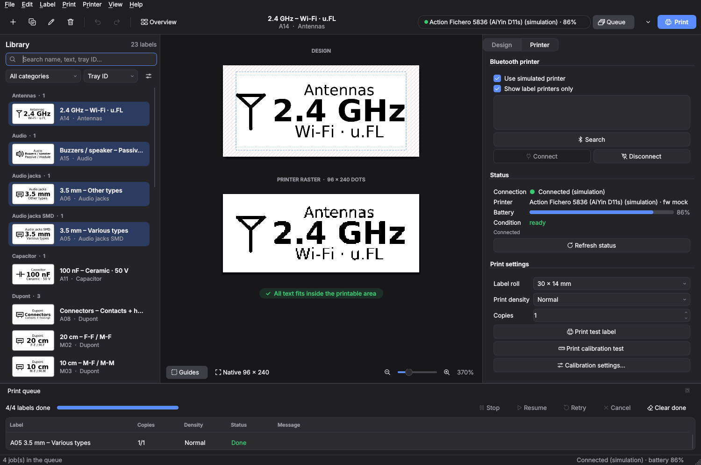

# Etiknivo

**Design, organise and print labels from your desktop.**

Etiknivo is an open-source desktop app for small label printers. Keep a library of labels, for a parts cabinet or workshop for example, design them with text, symbols and codes, and print them directly over Bluetooth.


## Features

- **Label library** with categories, search, sorting and multi-select.
- **What you see is what prints**: the preview is the exact bitmap sent to the printer.
- **Text, symbols and codes**: several lines of text, 70 built-in pictograms or your own image, QR codes and Code 128 barcodes.
- **Free layout**: drag text, codes, lines and frames exactly where you want them.
- **Linked fields** such as `{Voltage}`, `{Date}` and `{No}`, filled in per label or at print time.
- **Batch printing**: one label, a selection or a whole category, through a print queue with history.
- **Import and export**: CSV, JSON, PNG, true-size PDF and full backups.
- **Light and dark themes**, English and Dutch, on macOS, Windows and Linux.



## Supported printers

| Printer | Labels | Status |
|---|---|---|
| Action Fichero 5836 (AiYin D11s) | 30 × 14 mm and other 12 or 14 mm rolls | ✓ Tested |

The app also runs without a printer, using a built-in simulated printer. New printers can be added with a profile and a backend; see [Adding a printer type](docs/en/printer-types.md).

## Download

Download `Etiknivo-<version>-macOS.zip` from the [latest release](https://github.com/D8bp8Ags/Etiknivo/releases/latest), unzip it and drag **Etiknivo.app** to your Applications folder. The app is built for Macs with Apple Silicon.

The app is not signed with an Apple developer certificate, so macOS blocks it the first time:

- **macOS 15 Sequoia and later:** open the app once and close the warning. Then go to **System Settings → Privacy & Security**, scroll down and click **Open Anyway** next to the message about Etiknivo.
- **macOS 14 and earlier:** right-click (or Control-click) Etiknivo.app, choose **Open** and confirm.

After that, the app opens normally. The first time you search for a printer, macOS asks for Bluetooth access.

On Windows, Linux or an Intel Mac, run Etiknivo from source as described below.

## Installation from source

Etiknivo runs with [uv](https://docs.astral.sh/uv/getting-started/installation/), which installs the right Python version and all dependencies for you.

```bash
git clone https://github.com/D8bp8Ags/Etiknivo.git
cd Etiknivo
uv run etiknivo
```

Use `uv run etiknivo --mock` to start without a printer. On macOS the system asks for Bluetooth access the first time, for the app you run the command from (Terminal, iTerm, VS Code).

The interface follows your system language; choose another under **View → Language**.

## Getting started

1. Switch on the printer, open the **Printer** tab, click **Search** and then **Connect**.
2. Print a **test label** to check the connection.
3. Create or pick a label in the library and click **Print**.

On first start, 23 sample labels for electronic components are ready to use.


## Documentation

- [User guide](docs/en/user-guide.md): every feature, calibration, importing and troubleshooting.
- [Development](docs/en/development.md): architecture, tests, translations and building the app.
- [Printer protocol](docs/en/printer-protocol.md): the Bluetooth protocol of the Fichero 5836.
- [Adding a printer type](docs/en/printer-types.md): support for another label printer.

The documentation is also available in Dutch: [Nederlandse handleiding](docs/nl/handleiding.md). See the [documentation overview](docs/README.md) for all pages in both languages.

## License

MIT, see [LICENSE](LICENSE). The bundled DejaVu fonts have their own free license ([LICENSE-DejaVu.txt](src/etiknivo/fonts/LICENSE-DejaVu.txt)). The app icon and all pictograms are original designs.
