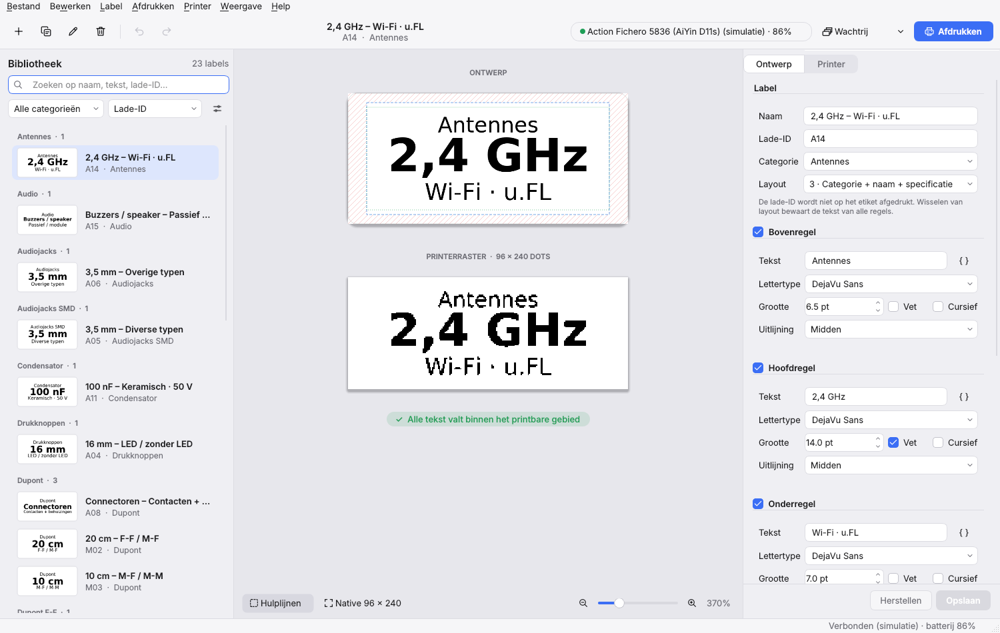
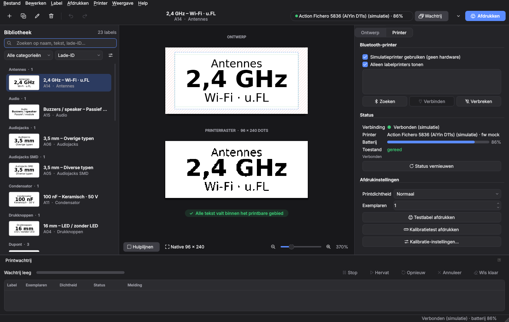
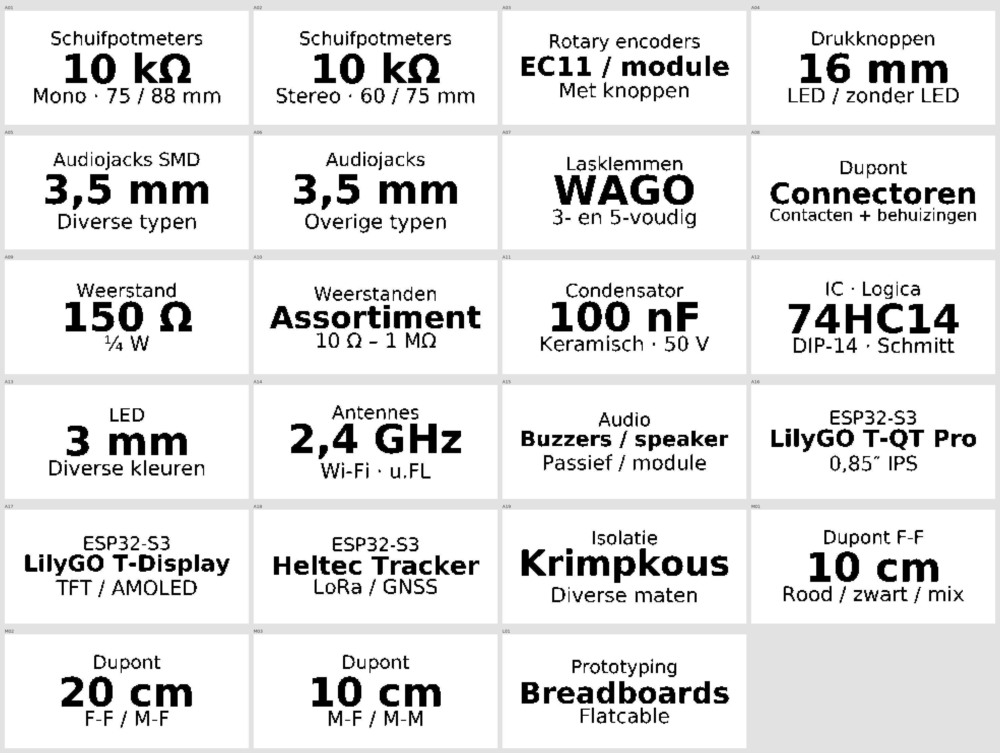

# Etiknivo

**Open-source Label Designer & Printer Manager**

Etiknivo is een desktopapplicatie (Python + PySide6) om etiketten te ontwerpen, te beheren en rechtstreeks via Bluetooth af te drukken. De eerste ondersteunde printer is de **Action Fichero 5836** (intern een AiYin D11s, 96-dots printkop, 203 dpi, etiketten van 30 × 14 mm). De opzet is printeronafhankelijk: een nieuwe labelprinter is een extra *printerprofiel* plus een *backend*.



**Gebruiker?** Lees de [handleiding](docs/handleiding.md): verbinden, labels maken, velden, afdrukken, kalibreren en problemen oplossen.



## Functies

- **Moderne interface** die automatisch de lichte of donkere modus van macOS volgt (of vast licht/donker via *Weergave → Thema*): werkbalk met printerstatus en afdrukknop, bibliotheek als kaartjes, het label als papier op een canvas en een inspector met *Ontwerp* en *Printer*.
- **Labelbibliotheek**: thumbnails (de echte 1-bit printeruitvoer), naam, categorie en lade-ID, zoeken, categoriefilter, sorteren, groeperen per categorie, meervoudige selectie, nieuw/dupliceren/hernoemen/verwijderen. Het label dat je bewerkt blijft altijd zichtbaar: krijgt het een andere categorie, dan springt het filter mee.
- **Opslaan per label** (⌘S): wijzigingen zijn een concept dat je direct in de preview ziet (met een stip in de lijst) tot je op Opslaan klikt. Herstellen zet het label terug; bij wisselen of afsluiten vraagt Etiknivo wat er met niet-opgeslagen wijzigingen moet gebeuren. Afdrukken gebruikt wat je ziet.
- **Ongedaan maken en opnieuw** (⌘Z / ⇧⌘Z) voor alle wijzigingen: tekst, opmaak, categorie, nieuw, dupliceren, verwijderen en importeren. Snel achter elkaar typen in hetzelfde label telt als één stap.
- **Editor met twee weergaven**:
  - *Ontwerpweergave* (antialiased, met de printbare band, marges en overflow gemarkeerd);
  - *Printerraster*: de exacte 1-bit bitmap van 96 × 240 dots die naar de printer gaat, inclusief kalibratie. Optioneel in native oriëntatie.
  - Zoom, waarschuwingen bij tekst buiten het printbare gebied.
- **Eigenschappen**: 1 tot 3 tekstregels, per regel lettertype (systeemlettertypen + meegeleverde DejaVu Sans), grootte, vet/cursief en uitlijning; verticale uitlijning, regelafstand, marges, automatisch passend maken, rotatie 0°/180°, rand, wit-op-zwart, technische specificaties en notities.
- **Gekoppelde velden**: zet `{Spanning}` in een tekstregel (of kies het via de knop `{ }`) en het etiket toont de waarde uit de specificaties van dat label. Pas je de specificatie aan, dan verandert het etiket mee. Ook `{Naam}`, `{Lade}` en `{Categorie}` werken. Specificaties en notities verschijnen als tooltip in de bibliotheek en zijn doorzoekbaar.
- **Drie standaardlayouts** (alleen naam; naam + specificatie; categorie + naam + specificatie). Wisselen bewaart de tekst van alle regels.
- **Eén renderengine** voor preview én print: supersampling (standaard 4×), box-filter downsampling, drempel naar 1-bit, kalibratie-offsets, rotatie naar het native raster. Speciale tekens zoals Ω µ ° × ¼ – ″ worden ondersteund; ontbreekt een teken in het gekozen lettertype, dan valt Etiknivo terug op DejaVu Sans en meldt dat.
- **Bluetooth-printerbeheer**: zoeken, verbinden/verbreken, opnieuw verbinden na een fout, batterij, status (deksel open, papier op, oververhit), printdichtheid licht/normaal/donker, aantal exemplaren, testlabel, kalibratietest en kalibratie-instellingen. Alle Bluetooth-I/O draait op een aparte asyncio-thread; de GUI blokkeert nooit.
- **Printwachtrij**: sequentieel, voortgang per opdracht, stopt bij een fout, mislukte opdrachten opnieuw uitvoeren, wachtende annuleren, dubbelklikbescherming. Resultaten en fouten gaan naar `print.log`.
- **Afdrukken**: huidig label, selectie, een hele categorie of alles, met afdrukvoorbeeld en aantallen per label.
- **Opslag en uitwisseling**: bibliotheek als JSON (met `.bak`), JSON import/export (samenvoegen of vervangen), CSV import/export, PNG-export van selecties (ontwerp of printerraster), PDF (ware grootte) en SVG, volledige back-up en herstel (zip).
- **Simulatieprinter**: de hele applicatie werkt zonder hardware. De simulatie staat overal als zodanig vermeld en drukt niets echt af.
- **Nederlands en Engels**: Weergave → Taal / Language kiest Nederlands, Engels of de taal van het systeem (na herstart). Vertalingen staan in `src/etiknivo/locale/en.py`; `uv run python scripts/i18n_strings.py --missing` toont teksten zonder vertaling, en een test bewaakt dat er geen ontbreken.
- **23 vooraf ingevulde Raaco-labels** voor elektronicacomponenten bij de eerste start (startdata in `src/etiknivo/data/raaco_seed.csv`).



## Installatie op macOS (Apple Silicon)

1. Installeer [uv](https://docs.astral.sh/uv/) als je het nog niet hebt:
   ```bash
   curl -LsSf https://astral.sh/uv/install.sh | sh
   # of: brew install uv
   ```
2. Haal de code op en start:
   ```bash
   git clone https://github.com/D8bp8Ags/Etiknivo.git etiknivo
   cd etiknivo
   uv run etiknivo
   ```
   `uv` installeert zelf Python 3.12+ en alle afhankelijkheden uit `uv.lock`.

Opties:

```bash
uv run etiknivo --mock     # start met de simulatieprinter
uv run etiknivo --debug    # uitgebreide logging
uv run etiknivo --version
```

### Bluetooth-toestemming

macOS vraagt de eerste keer om Bluetooth-toegang. Bij `uv run` geldt die toestemming voor de app waarin je het commando start (Terminal, iTerm, VS Code). Werkt zoeken niet, controleer dan **Systeeminstellingen → Privacy en beveiliging → Bluetooth** en zet de terminal-app aan. Op macOS zijn Bluetooth-adressen UUID's in plaats van MAC-adressen; dat is normaal.

## Eerste keer afdrukken

1. Zet de Fichero aan.
2. Open het tabblad **Printer**, klik **Zoeken**, kies `FICHERO_5836` en klik **Verbinden** (of dubbelklik). Het adres wordt onthouden.
3. Druk een **Testlabel** af, daarna een **Kalibratietest**. Het kalibratiepatroon toont het veilige printgebied van 26 × 12 mm (aan beide uiteinden blijft 2 mm leeg, net als in de officiële Fichero-app), de middellijnen en een millimeterliniaal. Is de witruimte aan beide uiteinden niet gelijk, pas dan via **Kalibratie-instellingen…** de verschuiving langs de rol aan (8 dots = 1 mm). De Fichero begint ongeveer 1 mm te vroeg te printen; daar corrigeert Etiknivo zelf al voor (8 dots), dus de kalibratie staat standaard op 0 en is alleen voor fijnafstemming. Komen labels ondersteboven uit, zet dan *Afdrukrichting omdraaien* aan.
4. Selecteer labels in de bibliotheek en kies **Afdrukken → Geselecteerde labels…** (⇧⌘P). Controleer het voorbeeld en het aantal exemplaren per label en bevestig.

## Belangrijk over het formaat

- De printkop is **96 dots** breed (12 mm bij 203 dpi). Het etiket is 14 mm hoog, dus 1 mm boven en onder kan fysiek niet bedrukt worden; Etiknivo gaat dus niet uit van 112 dots. De ontwerpweergave toont dat gebied gearceerd.
- Een label van 30 mm is 240 rasterregels (8 dots/mm, zoals het printerprotocol).
- Het ontwerp is liggend (240 × 112); het raster dat verstuurd wordt is 96 × 240. Etiknivo roteert 90° tegen de klok in. Klopt dat niet voor jouw printer, zet dan *Afdrukrichting omdraaien* aan.

## Printerprotocol

Etiknivo bevat een eigen implementatie van het Bluetooth-protocol van AiYin D11s-printers (de Fichero 5836). Het protocol staat beschreven in [docs/printer-protocol.md](docs/printer-protocol.md). Per exemplaar ziet een printopdracht er zo uit:

```
10 FF 10 00 nn       dichtheid (één keer per opdracht)
10 FF 40             status (deksel/papier/hitte), stop bij fout
10 FF 84 00          papiermodus: etiketten met tussenruimte (gap-detectie)
00 × 12              wake
10 FF FE 01          begin opdracht (D11s-specifiek)
1D 76 30 00 0C 00 F0 00 + 2880 bytes   ESC/POS-raster 96 × 240, MSB eerst, 1 = zwart
1D 0C                form feed: naar de volgende labelopening
10 FF FE 45          einde opdracht (D11s-specifiek), wacht op 0xAA/"OK"
```

Andere printers van hetzelfde platform gebruiken `10 FF F1 03` / `10 FF F1 45` om een opdracht te beginnen en te beëindigen; een D11s negeert die stilzwijgend. Een test controleert byte voor byte dat alleen de D11s-varianten worden verstuurd.

## Gegevens en bestanden

Alles staat lokaal, zonder account of cloud:

| Wat | macOS-locatie |
|---|---|
| Bibliotheek | `~/Library/Application Support/Etiknivo/library.json` (+ `library.json.bak`) |
| Instellingen en kalibratie | `~/Library/Application Support/Etiknivo/settings.json` |
| Logs | `~/Library/Logs/Etiknivo/app.log` en `print.log` |

Met `ETIKNIVO_DATA_DIR=/pad` gebruik je een andere map (handig voor testen). Via het menu **Bestand → Datamap openen** en **Help → Logmap openen** kom je er snel. **Help → Log tonen** (⌘L) laat de log live in de app zien, met een filter op waarschuwingen/fouten of printopdrachten, zoeken en een knop om te kopiëren.

### CSV-formaat

Scheidingsteken `,` of `;` wordt automatisch herkend, UTF-8 of Windows-1252. Alleen `main` is verplicht:

```csv
tray_id,category,main,spec,notes,layout
B01,Weerstand,1 kΩ,¼ W,in doos 2,
B02,Condensator,10 µF,Elektrolytisch · 25 V,,
,,Alleen een naam,,,single
```

Nederlandse kolomnamen werken ook (`lade`, `categorie`, `hoofdtekst`, `specificatie`, `notities`). Optionele kolommen: `top` (afwijkende bovenregel), `name`, `layout` (`single`, `main_spec`, `category_main_spec`, `custom`), `specs` (`Spanning=50 V; Tolerantie=10%`).

## Architectuur

```
src/etiknivo/
├── app.py                 start (uv run etiknivo)
├── model.py               labeldatamodel (Label, TextLine, LabelStyle, layouts)
├── settings.py            instellingen, kalibratie, datamappen
├── logging_setup.py       app.log en print.log
├── storage/               bibliotheek (JSON), import/export (JSON, CSV, back-up)
├── rendering/             renderengine, lettertypen, export (PNG/PDF/SVG), test- en kalibratiepatronen
├── printing/
│   ├── profiles.py        printerprofielen: geometrie, marges, dichtheden (Fichero 5836: 96 dots, 203 dpi, 30 × 14 mm)
│   ├── registry.py        ondersteunde modellen: welk profiel bij welke backend hoort
│   ├── backend.py         abstracte PrinterBackend en foutklassen
│   ├── d11s_protocol.py   opdrachten en antwoorden van de D11s (alleen bytes, geen I/O)
│   ├── ble_link.py        Bluetooth LE-verbinding (GATT-profiel kiezen, verzoek/antwoord, blokken)
│   ├── d11s_backend.py    printerbackend voor de Fichero 5836 / AiYin D11s
│   ├── mock.py            simulatieprinter
│   ├── queue.py           sequentiële printwachtrij
│   ├── runner.py          asyncio-loop in een achtergrondthread
│   └── manager.py         verbinding, status-polling en wachtrij (GUI-onafhankelijk)
└── gui/                   PySide6: hoofdvenster, bibliotheek, editor, eigenschappen, printer, wachtrij
    └── theme.py           kleuren (licht/donker), stylesheet en pictogrammen
```

Een andere labelprinter toevoegen kost drie stappen; zie [docs/printertypes.md](docs/printertypes.md).

## Tests

```bash
uv run pytest
```

De tests draaien zonder printer en zonder scherm (Qt `offscreen`). Ze dekken rendering (rasterafmetingen, oriëntatie, kalibratie, speciale tekens, kleine letters, lange tekst en overflow, alle 23 voorbeeldlabels), JSON/CSV/back-up, de printwachtrij (volgorde, exemplaren, dubbelklik, fout stopt de wachtrij, opnieuw proberen, deksel open, papier op, verbinding weg en opnieuw verbinden), het D11s-protocol en de backend via een nagebootste BLE-verbinding (exacte bytes, profielkeuze, gefragmenteerde antwoorden) en GUI-scenario's met de simulatieprinter.

Afdrukken is daarnaast getest met een echte Fichero 5836.

## macOS-app bouwen (optioneel)

```bash
uv sync --group build
uv run pyinstaller packaging/etiknivo.spec --noconfirm
open dist/Etiknivo.app
```

De bundle bevat het app-icoon (`packaging/etiknivo.icns`) en de vereiste `NSBluetoothAlwaysUsageDescription`. Omdat de app niet ondertekend is, start je hem de eerste keer met rechtermuisklik → **Open**.

## Licentie

MIT, zie [LICENSE](LICENSE). De meegeleverde DejaVu-lettertypen vallen onder hun eigen vrije licentie ([LICENSE-DejaVu.txt](src/etiknivo/fonts/LICENSE-DejaVu.txt)). Het app-icoon en alle pictogrammen zijn eigen ontwerpen en vallen ook onder MIT.
