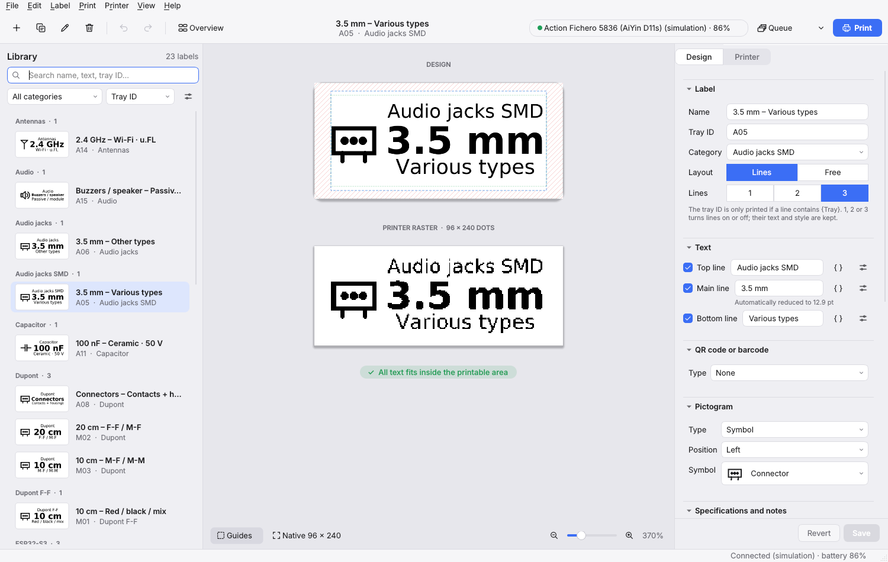
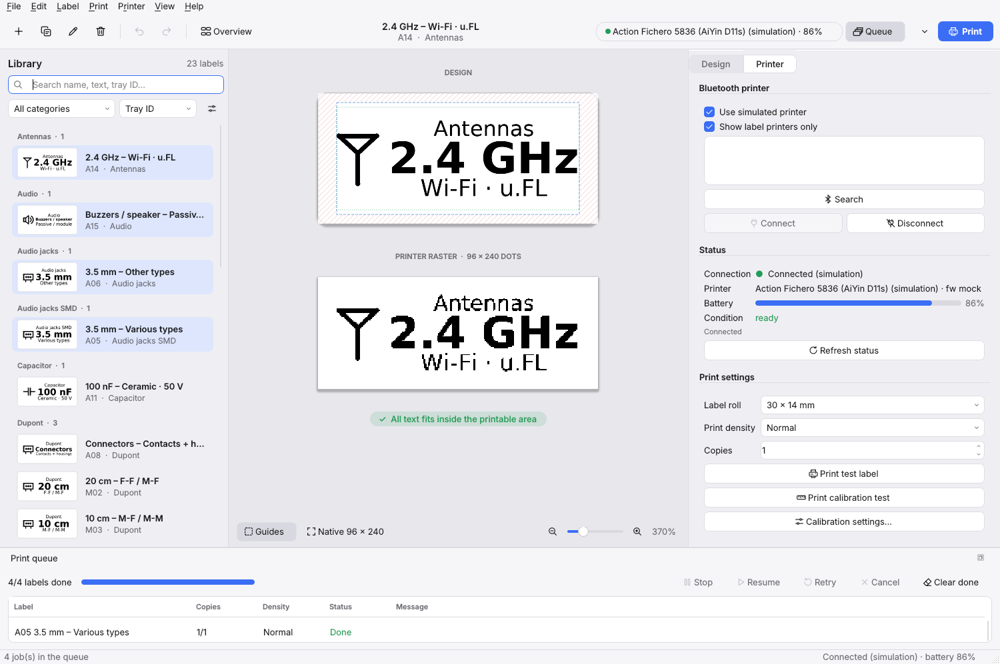
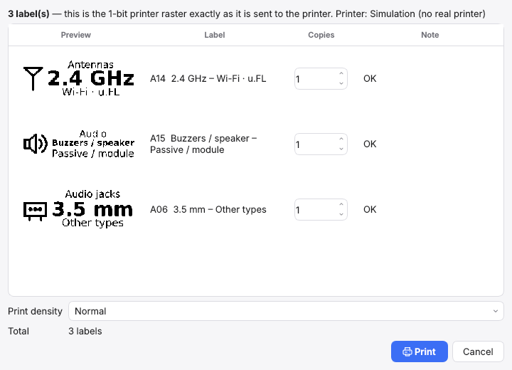
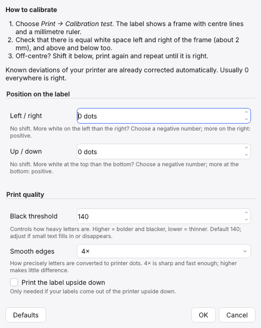
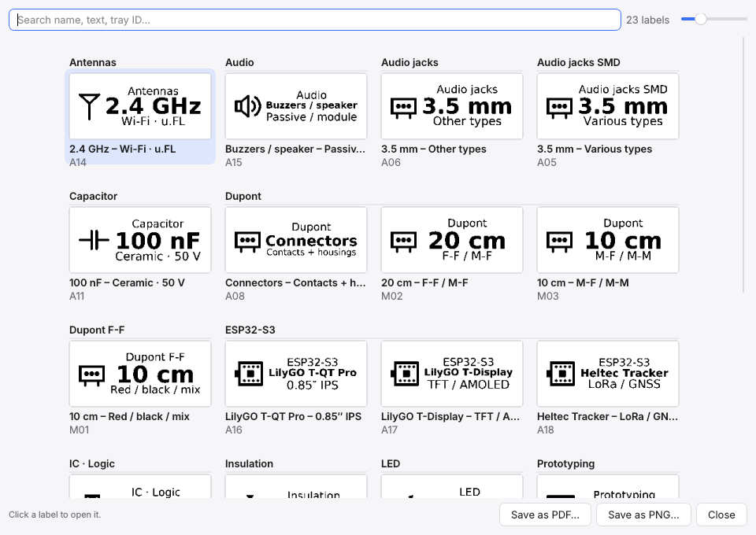

# Etiknivo user guide

*[Nederlandse versie](../nl/handleiding.md)*

Etiknivo designs and prints labels on the Action Fichero 5836, 30 × 14 mm by default and other sizes as well. This guide explains how to use the app. Installation is covered in the [README](../../README.md); technical details are in [Development](development.md).

The screenshots and menu names in this guide are from the English interface. Choose the language under **View → Language / Taal**.

- [The window](#the-window)
- [Connecting the printer](#connecting-the-printer)
- [Creating and editing a label](#creating-and-editing-a-label)
- [Specifications and linked fields](#specifications-and-linked-fields)
- [Pictograms and images](#pictograms-and-images)
- [QR code and barcode](#qr-code-and-barcode)
- [Free layout: dragging elements](#free-layout-dragging-elements)
- [Printing](#printing)
- [A different label roll](#a-different-label-roll)
- [Calibrating](#calibrating)
- [Managing the library](#managing-the-library)
- [Label overview](#label-overview)
- [Import, export and backup](#import-export-and-backup)
- [Language and theme](#language-and-theme)
- [New versions](#new-versions)
- [Troubleshooting](#troubleshooting)
- [Keyboard shortcuts](#keyboard-shortcuts)

## The window



The window has three parts:

- **The library on the left**: all your labels as cards with a real print preview. At the top you search, pick a category and choose how the list is sorted.
- **The previews in the middle**. *Design* shows the label as you design it; the hatched edges cannot be printed and the dotted line is the safe margin. *Printer raster* shows exactly the black and white dots that go to the printer. Below them you see whether all text fits.
- **The inspector on the right** with two tabs: *Design* (text, font, layout) and *Printer* (connection, density, calibration).

Along the top is the toolbar with new, duplicate, rename, delete, undo and redo. To the right of it are the printer status, the **Queue** button and the blue **Print** button.

## Connecting the printer



1. Switch on the Fichero.
2. Open the **Printer** tab on the right and click **Search**. With *Show label printers only* switched on, you only see printers Etiknivo knows.
3. Choose `FICHERO_5836` in the list and click **Connect**, or double-click it. Etiknivo remembers the printer, so it shows up straight away next time.

Under *Status* you see the battery level and whether the printer is ready. If the cover is open or the paper has run out, it says so there too, and printing stops until the problem is solved.

The first time, macOS asks for Bluetooth access. Grant it to the app you start Etiknivo from (the app itself, or Terminal if you use `uv run`). Windows and Linux don't ask; just make sure Bluetooth is on.

**Working without a printer.** Switch on *Use simulated printer*. The app then behaves as if a printer is connected, but nothing is printed. "(simulation)" is shown everywhere, so you don't forget.

## Creating and editing a label

Click **+** in the toolbar (⌘N). You pick a category and the label opens in the inspector.

### Details

- **Name**: what the label is called in the library.
- **Tray ID**: for example `A14`, used for sorting. It is not printed on the label, unless you put `{Tray}` in a text line.
- **Category**: groups labels in the library. Pick an existing one or type a new one.
- **Layout**: **Lines** or **Free**. With *Lines*, up to three text lines sit below each other, with a QR code or barcode and a pictogram next to them. With *Free*, you place separate elements wherever you like (see [Free layout](#free-layout-dragging-elements)).
- **Lines** (only with *Lines*): the quick buttons **1**, **2** and **3** switch lines on or off.

| Button | Lines on the label |
|---|---|
| 1 | only the main line |
| 2 | main line and bottom line |
| 3 | top line, main line and bottom line |

The quick buttons only change which lines are switched on. Text, font, size and alignment of every line are kept. You can also tick a line on or off yourself; if the combination doesn't match a button, no button is selected.

### Text lines

Under **Text**, each line (Top line, Main line, Bottom line) has its own row: the checkbox switches it on or off, next to it you type the text and insert a field with { }. The button with the sliders expands the font, size, style (bold and italic) and alignment of that line; hover over it to see them without expanding.

The panel on the right consists of sections: Label, Text, QR code or barcode, Pictogram, Specifications and notes, and Style. Click a title to collapse or expand a section; Etiknivo remembers this. A collapsed section shows a short summary after its title, for example *QR code on the left · {Tray}*.

Below the lines are settings for the whole label: vertical alignment, line spacing, margins, *Shrink text to fit* (makes the text smaller until everything fits), rotation, a border around the label, a thin line between the text lines and white on black.

With *Rotation* you can also turn the text a quarter turn: **90°** reads from bottom to top, **270°** from top to bottom. This is useful for narrow drawers or when you stick the label on upright. The lines then run below each other along the length of the label. Because the label is only 12 mm wide, they often get smaller; shorten the text if it becomes too small.

Special characters such as Ω, µ, °, ×, ¼ and ″ just work. If the chosen font lacks a character, Etiknivo uses DejaVu Sans for that character and says so below the preview.

### Saving and reverting

Your changes start out as a draft. The label gets a blue dot in the library, and the bottom of the inspector says there are unsaved changes.

- **Save** (⌘S) stores the label in the library.
- **Revert** puts the label back to the last saved version.

If you pick another label or quit the app while there is a draft, Etiknivo asks whether you want to save, discard or cancel. **Undo** (⌘Z) and **Redo** (⇧⌘Z) work on all changes, including deleting and importing.

You can also print a draft without saving it first; what you see on screen is printed.

## Specifications and linked fields

At the bottom of the *Design* tab are **Specifications** and **Notes**.

Specifications are a table with a **name** and a **value**. Click **+ Specification** and fill in, for example:

| Name | Value |
|---|---|
| Voltage | 50 V |
| Tolerance | 10% |
| Package | 0805 |

Type `{Voltage}` in a text line and `50 V` appears on the label. Quicker: click **{ }** after the specification and choose the line it should go in. The **{ }** button next to a text field works too: it lists this label's specifications at the top and below them the fields every label has, each with a short explanation. If you change the value later, the label follows automatically. Upper and lower case don't matter.

The braces only belong in the text line, not in the table and not in the notes. If you type them in a specification name anyway, Etiknivo ignores them. A `{field}` in a value or in the notes gives an orange warning, because nothing is filled in there.

Besides your own specifications, `{Name}`, `{Tray}` and `{Category}` always work. A field that doesn't exist stays as plain text and gives a warning below the preview, so you spot a typo straight away. The Dutch field names (`{Naam}`, `{Lade}`, `{Categorie}`, `{Datum}`, `{Nr}`, `{Aantal}`) work as well, so labels work in both languages.

### Date and copy number

Three fields are only filled in at print time:

| Field | Becomes | Example |
|---|---|---|
| `{Date}` | today's date | 2026-10-24 |
| `{No}` | the number of this copy within the print job | 1, 2, 3 … |
| `{Count}` | the number of copies in the print job | 3 |

If you print 3 copies of a label with `Box {No}/{Count}`, you get *Box 1/3*, *Box 2/3* and *Box 3/3*. Every print job starts counting at 1 again. The preview and exports show copy 1 of 1. If you have a specification of your own called *Count* (or *Date*, *No*), the label uses your value.

**Notes** are just for you, for example where you ordered something. They are not printed. The field grows with your text. Links (such as a web address or email address) are underlined: ⌘-click a link to open it, and they are also listed as clickable links under the field, under *Open*. Specifications and notes are searchable and appear as a tooltip when you hover over a label in the library.

## Pictograms and images

Below *QR code or barcode* is **Pictogram**. Under *Type* you choose:

- **Symbol**: one of the 70 built-in symbols. The list groups them by category:
  - *Electronics*: resistor, potentiometer, capacitor, electrolytic capacitor, inductor, diode, LED, transistor, IC, crystal, fuse, switch, ground, speaker, antenna, push button, knob, development board and breadboard.
  - *Power and cables*: battery, battery cell, voltage, lamp, socket, plug, USB, connector, cable and heat shrink.
  - *Fasteners*: screw, bolt, nut, washer, nail, wall plug, hook and spring.
  - *Tools*: hammer, screwdriver, wrench, saw, ruler and drill.
  - *Home and kitchen*: house, jar, bottle, mug, cutlery, freezer, flame, water and plant.
  - *Office and storage*: box, folder, document, envelope, pencil, scissors, book, label and key.
  - *Signs*: warning, prohibited, information, check mark, cross, this way up, fragile, star and heart.
- **Own image**: click **Choose image…** and pick a PNG, JPG or SVG, for example your logo. Etiknivo turns it black and white, trims white borders and stores it inside the label. You no longer need the original file, and the image travels along in exports and backups.

With *Position* you put the pictogram to the left or right of the text. The text moves aside and gets smaller if needed. To pick a fitting symbol for all your labels at once, use [Label → Pictograms…](#choosing-pictograms). If a QR code and a pictogram are on the same side, the QR code goes on the outside and the pictogram next to it.

Images with lots of small details or soft colour gradients often become unclear at 12 mm. Simple shapes with thick lines work best.

## QR code and barcode

Below the text lines is **QR code or barcode**. Under *Type* you choose:

- **QR code on the left** or **QR code on the right**: a square code next to the text, to scan with your phone. The text moves aside and gets smaller if needed. With **Size** you choose *Small*, *Medium* (default) or *Large*. Small leaves the most room for text and still scans fine with a phone when the content is short, such as `{Tray}`; Large scans most easily.
- **Barcode (Code 128) at the bottom**: a barcode below the text, for a handheld scanner. All lines stay and get smaller if needed; with fewer lines (buttons 1/2/3) the text gets bigger.

Under *Content* you set what the code contains. By default this is `{Tray}`, the tray ID. Fields work just like in the text lines, so with a specification `Datasheet: https://…` and `{Datasheet}` as the content, the QR code opens that link. An unknown field gives a warning and then no code is printed, so you never print a code with `{…}` in it.

The shorter the content, the bigger the modules or bars and the easier it scans. A QR code holds up to 134 characters, but it scans best up to about 40 characters. A barcode holds up to about 15 characters (twice as many digits) and can only contain letters, digits and punctuation without accents; Ω or µ give a warning.

Etiknivo creates QR codes and barcodes itself, without an external library or internet.

## Free layout: dragging elements

If you want more freedom than three lines below each other, choose **Free** under *Layout*. Whatever is on the label (the lines, the QR code or barcode and the pictogram) is then turned into separate **elements** in exactly the same place. So at first the label looks the same.

- **Select and drag**: click an element in the design and drag it. The blue corner at the bottom right makes it bigger or smaller. Everything snaps to whole dots (0.125 mm), so what you see is exactly what is printed.
- **Keys**: the arrow keys move the selected element 1 dot, with Shift 1 mm. Delete removes it.
- **Add**: with **Add ▾** below the list you choose a text, QR code, barcode, symbol, image, line or frame. The ▲ and ▼ buttons decide what lies on top when elements overlap.
- **Settings**: below the list are the position and size in mm and, depending on the element, the content, font, symbol or image.

Text gets as big as you set it, but shrinks if it doesn't fit its box. Codes, symbols and images are made as large as possible inside their box. A symbol fills its box right up to the edge, with no white space around it. A **line** fills its whole box, so a flat box is a stripe and a square box a black block. A **frame** is a 1-dot border around the box. Fields such as `{Tray}`, `{Date}` and `{No}` work in all text and codes.

If you go back to *Lines*, you get your three lines back as they were. The elements are kept for when you choose *Free* again. If you changed the lines in the meantime, Etiknivo asks whether you want to **make the elements again** from the lines or **keep your earlier free layout**. Margins, line spacing and rotation don't apply in the free layout, because you place everything yourself. With **Copy format → Layout**, other labels get the same elements. Use fields such as `{Name}` and `{Tray}` in the text, and each label shows its own details.

## Printing

There are four ways to print, all in the **Print** menu and in the arrow next to the blue button:

- **Current label** (⌘P), also with the blue button at the top right.
- **Selection** (⇧⌘P): the labels selected in the library. Select several labels with ⌘-click or ⇧-click.
- **Category**: all labels in one category.
- **All labels**.



First you see a preview with exactly what will be printed. Set the number of copies per label, and the print density (light, normal or dark) at the bottom. *Note* tells you if text doesn't fit or a field is unknown.

After **Print**, the labels go to the **queue** (the *Queue* button at the top right, or View → Print queue). The queue prints them one by one and shows the progress of each job:

- **Stop** pauses after the current label; **Resume** continues.
- If something goes wrong (cover open, out of paper, connection lost), the queue stops. Fix the problem and click **Retry**.
- **Cancel** removes waiting jobs; **Clear done** tidies up finished ones.

Set the default number of copies and the default density on the *Printer* tab. Small text is often easier to read on *Light* or *Normal* than on *Dark*.

### Print history

**Print → Print history…** shows which labels were printed when, with the number of copies and the density. Search by tray or name, and tick *Hide simulation* to see only real prints.

Select one or more rows and click **Print again…** (or double-click). You get the usual print preview with the same number of copies and density as before. The label is printed as it is now, so including your later changes. Deleted labels are greyed out and cannot be printed again. Test labels and calibration tests are not added to the history.

The history keeps the last 1000 jobs in `print_history.json` in the data folder.

## A different label roll

If the printer holds a roll of a different size, choose it on the *Printer* tab under **Label roll**. The list has the common sizes, for example 30 × 14, 40 × 14, 50 × 14 and 40 × 12 mm. If your size isn't listed, choose **Custom…** and enter the length and height of a single label, without the gap. The length is the direction in which the paper comes out of the printer.

The choice applies to all labels. The design, the previews, the cards in the library and printing adjust straight away. The text of your labels stays as it is; with *Shrink text to fit* on, it gets bigger or smaller by itself. Etiknivo remembers the roll.

The print head prints at most 12 mm high. If a label is taller, a strip above and below stays empty; it is hatched in the design. Print a **Calibration test** after changing rolls to check that everything lines up.

## Calibrating

Use this when the print isn't nicely centred on the label.

1. On the *Printer* tab or in the **Printer** menu, choose **Print calibration test**. The label shows a frame around the safe area, centre lines and a millimetre ruler.
2. Check that the white space left and right, and above and below, is equal.
3. Open **Printer → Calibration settings…** and shift the print.



- **Left / right**: positive moves the print to the right, negative to the left. 8 dots is 1 mm; the window converts it for you.
- **Up / down**: positive moves it down, negative up.
- **Black threshold**: higher makes letters thicker and blacker, lower thinner. Default 140.
- **Smooth edges**: how precisely letters are converted to printer dots. 4× is usually fine.
- **Print the label upside down**: switch this on if labels come out of the printer upside down.

Then print another calibration test to check. The Fichero itself starts about 1 mm too early; Etiknivo already corrects for this, so usually no calibration is needed.

## Managing the library

- **Search** looks through the name, the text on the label, the tray ID, specifications and notes.
- **Category** shows only the labels in one category.
- **Sort** by tray ID, name, category or last modified.
- The button with the sliders switches **Group by category** on or off.
- **Duplicate** (⌘D) makes a copy, to create a similar label quickly.
- **Rename** (F2) and **Delete** also work on several selected labels; deleting can be undone.

### New labels in a category

A new label automatically gets the format of the label you last edited in the same category: layout, fonts, style, code and pictogram. The text starts empty. If a category filter is active, this happens straight away with **New label**. If you choose the category later, it happens at that moment, but only if you haven't changed the new label's format yourself yet.

### Copy format

If you want a whole category to look the same, make one label look good and choose **Label → Copy format…** (or right-click in the library). Tick what should be copied:

- **Layout and fonts**: which lines are visible, and font, size, bold, italic and alignment per line.
- **Style**: vertical alignment, line spacing, margins, shrink to fit, rotation, border, lines between lines and white on black.
- **QR code or barcode**: type, position and content. Fields such as `{Tray}` are filled in per label.
- **Pictogram**: symbol or image and its position.

Then choose which labels it applies to: the selected labels, all labels in a category, or all labels. The button shows how many labels will change. The text, specifications and notes of those labels stay as they were. If the result isn't right, ⌘Z undoes everything at once.

### Choosing pictograms

With **Copy format** every label gets the same pictogram. If you want a fitting symbol per drawer, choose **Label → Pictograms…**. The window shows your categories with their labels below them.

- **Per category**: click the pictogram next to a category (with ▾) and pick a symbol. Etiknivo suggests one based on the name (a resistor for *Resistors*, an antenna for *Antennas*, a connector for *Dupont*, and so on). Your choice is remembered: a new label in that category gets the same pictogram. *None* means deliberately no pictogram.
- **Per label**: a label follows its category (grey, with ↳). If you want something else, select one or more labels and choose **Own pictogram…**; **Follow category** puts them back.
- **Include or skip**: only ticked labels are changed. Tick a category on or off for all its labels, or select several labels (Shift-click) and choose **Include** or **Skip**.
- **Search** at the top narrows the list; *Position* chooses left or right of the text for labels that didn't have a pictogram yet.

Labels with an image of their own stay as they are. If more than one label is selected in the library, only those labels are ticked. ⌘Z undoes everything at once.

### Editing many labels at once

**Label → Edit labels…** (⌘E, also in the library's right-click menu) shows all your labels in one table, with the name, tray ID, category and the three lines. Double-click a cell or just start typing to change it. If you select several rows (Shift- or ⌘-click) and type a value, all selected labels get it. That way you move ten labels to another category in one go. Changed cells turn blue, the search field at the top narrows the list, and nothing changes until you click **Apply**. ⌘Z undoes everything at once.

The pictogram is the same size on every label, so a drawer cabinet looks tidy. Only when a line wouldn't fit otherwise does the pictogram get smaller on that label.

On first start there are 23 sample labels for Raaco drawers with electronic components. You can simply change or delete them.

## Label overview

The **Overview** button in the toolbar (or *View → Label overview*, ⇧⌘O) shows all your labels at once, as they will be printed, grouped by category with the name and tray ID below them. Small categories sit next to each other, so you see many drawers at a glance.



- **Click** a label to open it in the main window. This also works when a search or category filter hides it in the library.
- **Search** at the top narrows the overview; the slider next to it makes the labels bigger or smaller.
- **Save as PDF** creates A4 pages with the labels at true size, handy to print and hang next to your drawer cabinet. **Save as PNG** creates one long image. Both only include the labels you currently see.

The overview shows the saved version of each label and updates itself when you save, import or add labels.

## Import, export and backup

Everything is in the **File** menu; import and export each have their own submenu.

| What | What for |
|---|---|
| Import/Export → Library (JSON) | Exchange complete labels between computers. When importing, you choose merge or replace. |
| Import/Export → Labels (CSV) | Create or update labels in Excel, Numbers or Google Sheets. The format is described [below](#csv-format). |
| Export → Selection as PNG or PDF, Current label as SVG | An image of the label, for example to share or to use on another printer. PDF is at true size. |
| Create backup / Restore backup | One zip file with the library and settings. |
| Open data folder | The folder where Etiknivo keeps everything. |

Etiknivo keeps everything locally on your own computer. Every time it saves, the previous version is kept as `library.json.bak`.

### Where your data is

| What | File |
|---|---|
| Library | `library.json` (+ `library.json.bak`) in the data folder |
| Settings and calibration | `settings.json` in the data folder |
| Print history | `print_history.json` in the data folder |
| Logs | `app.log` and `print.log` in the log folder |

| System | Data folder | Log folder |
|---|---|---|
| macOS | `~/Library/Application Support/Etiknivo` | `~/Library/Logs/Etiknivo` |
| Windows | `%LOCALAPPDATA%\Etiknivo` | `%LOCALAPPDATA%\Etiknivo\Logs` |
| Linux | `~/.local/share/Etiknivo` | `~/.local/state/Etiknivo/log` |

**File → Open data folder** and **Help → Open log folder** take you there quickly.

### CSV format

The separator `,` or `;` is detected automatically, in UTF-8 or Windows-1252. Only `main` is required:

```csv
tray_id,category,main,spec,notes,layout
B01,Resistor,1 kΩ,¼ W,in box 2,
B02,Capacitor,10 µF,Electrolytic · 25 V,,
,,Just a name,,,single
```

The column names are the same in both languages, so an export from the English app can be read by the Dutch one and the other way round. Dutch column names work too (`lade`, `categorie`, `hoofdtekst`, `specificatie`, `notities`). Optional columns: `top` (a different top line), `name`, `layout` (`single`, `main_spec`, `category_main_spec`, `custom`), `specs` (`Voltage=50 V; Tolerance=10%`).

## Language and theme

- **View → Language / Taal**: Nederlands, English, or your system language. Restart the app to switch.
- **View → Theme**: light, dark, or follow the system.
- **View → Guides** shows or hides the margins in the design preview.

## New versions

**Help → Check for updates…** checks GitHub for a newer version of Etiknivo. If there is one, you can open the download page; Etiknivo never downloads or installs anything itself. If you switch on **Help → Check for updates at start-up**, the app checks at most once a day when it starts, and only says something when there is a new version. This is off by default.

## Troubleshooting

**The printer isn't found.** Check that the printer is switched on and not connected to your phone; a Bluetooth printer usually talks to only one device at a time. In System Settings → Privacy & Security → Bluetooth, check that Etiknivo (or your terminal) has access. Briefly switch off *Show label printers only* to see whether the printer is visible at all. On Windows and Linux: see [Installing per system](development.md#installing-per-system).

**The connection drops.** Click **Connect** again; resume an interrupted queue with **Retry**. If you switch the printer off and on, connect again.

**The print is crooked or too far to one side.** See [Calibrating](#calibrating).

**Text is too faint or too heavy.** Try another print density, or adjust the black threshold in the calibration settings. For small text, choose a bigger or bold font.

**It says a line "is outside the printable area".** Make the text shorter or smaller, or switch on *Shrink text to fit*.

**Something else goes wrong.** Open **Help → Show log** (⌘L). The *Warnings and errors* filter shows only warnings and errors. **Copy** puts the visible lines on the clipboard, so you can send them on. **Help → About Etiknivo** lets you copy the system information as well.

## Keyboard shortcuts

On Windows and Linux, use Ctrl instead of ⌘.

| Key | Action |
|---|---|
| ⌘N | New label |
| ⌘S | Save label |
| ⌘D | Duplicate |
| F2 | Rename |
| ⌘Z / ⇧⌘Z | Undo / redo |
| ⌘P | Print current label |
| ⇧⌘P | Print selection |
| ⇧⌘O | Label overview |
| ⌘L | Show log |
| ⌘Q | Quit |
