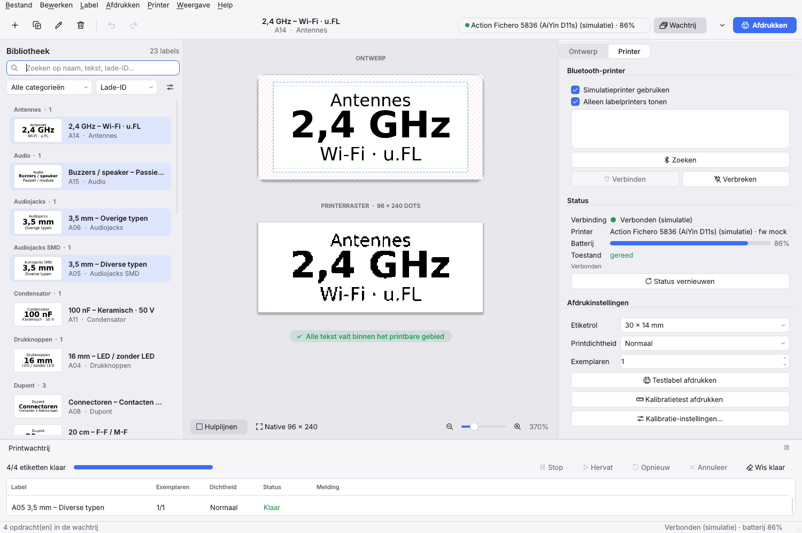
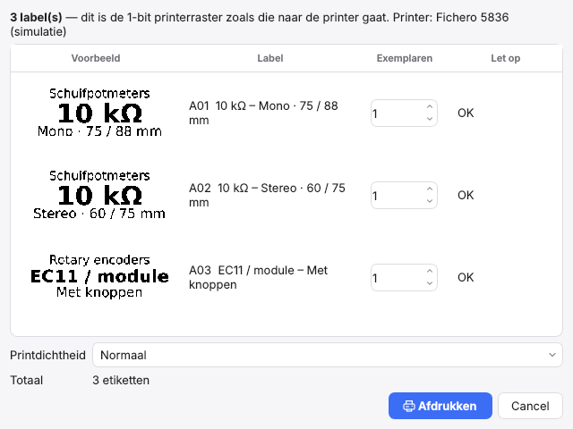
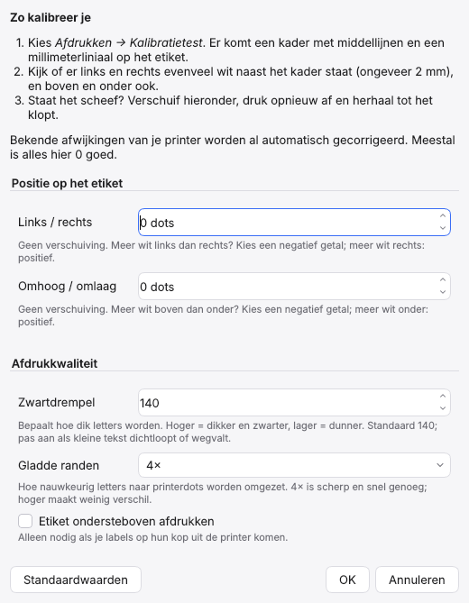
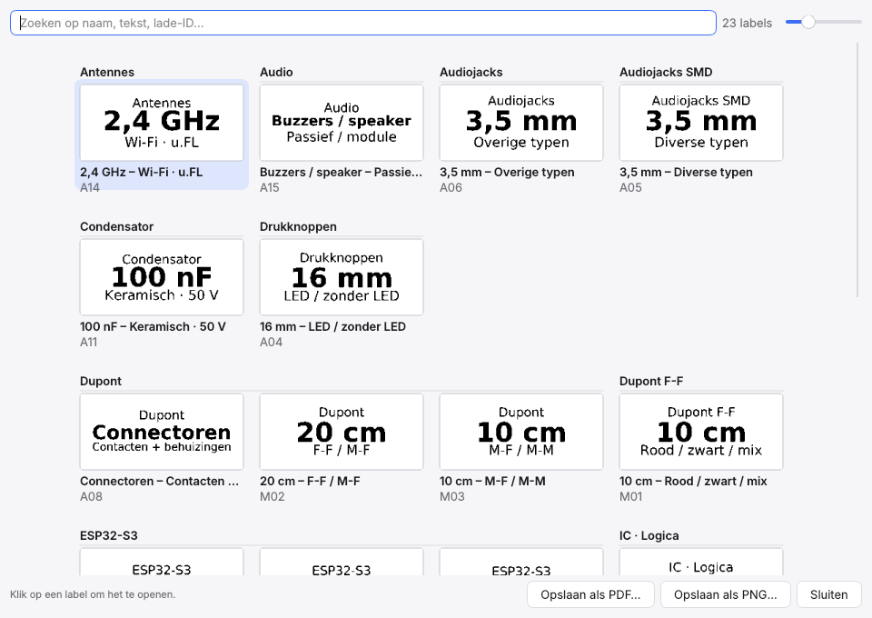

# Handleiding Etiknivo

Etiknivo maakt en print etiketten op de Action Fichero 5836, standaard 30 × 14 mm en ook andere maten. Deze handleiding legt uit hoe je de app gebruikt. Installeren staat in de [README](../README.md); technische details staan in [Ontwikkelen](ontwikkelen.md).

- [Het venster](#het-venster)
- [De printer verbinden](#de-printer-verbinden)
- [Een label maken en bewerken](#een-label-maken-en-bewerken)
- [Specificaties en gekoppelde velden](#specificaties-en-gekoppelde-velden)
- [Pictogrammen en afbeeldingen](#pictogrammen-en-afbeeldingen)
- [QR-code en barcode](#qr-code-en-barcode)
- [Vrije layout: elementen slepen](#vrije-layout-elementen-slepen)
- [Afdrukken](#afdrukken)
- [Een andere etiketrol](#een-andere-etiketrol)
- [Kalibreren](#kalibreren)
- [De bibliotheek beheren](#de-bibliotheek-beheren)
- [Labeloverzicht](#labeloverzicht)
- [Importeren, exporteren en back-up](#importeren-exporteren-en-back-up)
- [Taal en thema](#taal-en-thema)
- [Nieuwe versies](#nieuwe-versies)
- [Problemen oplossen](#problemen-oplossen)
- [Sneltoetsen](#sneltoetsen)

## Het venster


Het venster heeft drie delen:

- **Links de bibliotheek**: al je labels als kaartjes met een echt printvoorbeeld. Bovenaan zoek je, kies je een categorie en hoe er gesorteerd wordt.
- **In het midden de voorbeelden**. *Ontwerp* toont het label zoals je het ontwerpt; de gearceerde randen kan de printer niet bedrukken en de stippellijn is de veilige marge. *Printerraster* toont exact de zwarte en witte puntjes die naar de printer gaan. Daaronder staat of alle tekst past.
- **Rechts de inspector** met twee tabbladen: *Ontwerp* (tekst, lettertype, layout) en *Printer* (verbinden, dichtheid, kalibratie).

Bovenaan staat de werkbalk met nieuw, dupliceren, hernoemen, verwijderen, ongedaan maken en opnieuw. Rechts daarvan zie je de printerstatus, de knop **Wachtrij** en de blauwe knop **Afdrukken**.

## De printer verbinden



1. Zet de Fichero aan.
2. Open rechts het tabblad **Printer** en klik **Zoeken**. Met *Alleen labelprinters tonen* aan zie je alleen printers die Etiknivo kent.
3. Kies `FICHERO_5836` in de lijst en klik **Verbinden**, of dubbelklik erop. Etiknivo onthoudt de printer, zodat je hem de volgende keer meteen terugziet.

Onder *Status* zie je de batterij en of de printer klaar is. Is het deksel open of het papier op, dan staat dat daar ook, en stopt het afdrukken tot het opgelost is.

De eerste keer vraagt macOS om toestemming voor Bluetooth. Geef die aan de app waarmee je Etiknivo start (de app zelf, of Terminal als je `uv run` gebruikt). Op Windows en Linux hoeft dat niet; zet daar alleen Bluetooth aan.

**Zonder printer werken.** Zet *Simulatieprinter gebruiken* aan. De app doet dan alles alsof er een printer is, maar drukt niets af. Overal staat "(simulatie)" bij, zodat je het niet vergeet.

## Een label maken en bewerken

Klik **+** in de werkbalk (⌘N). Je kiest een categorie en het label opent in de inspector.

### Gegevens

- **Naam**: hoe het label in de bibliotheek heet.
- **Lade-ID**: bijvoorbeeld `A14`, om op te sorteren. Komt niet op het etiket, tenzij je `{Lade}` in een tekstregel zet.
- **Categorie**: groepeert labels in de bibliotheek. Kies een bestaande of typ een nieuwe.
- **Layout**: **Regels** of **Vrij**. Bij *Regels* staan er tot drie tekstregels onder elkaar, met een QR-code of barcode en een pictogram ernaast. Bij *Vrij* zet je losse elementen waar je wilt (zie [Vrije layout](#vrije-layout-elementen-slepen)).
- **Regels** (alleen bij *Regels*): de snelknoppen **1**, **2** en **3** zetten regels aan of uit.

| Knop | Regels op het etiket |
|---|---|
| 1 | alleen de hoofdregel |
| 2 | hoofdregel en onderregel |
| 3 | bovenregel, hoofdregel en onderregel |

De snelknoppen veranderen alleen welke regels aan staan. Tekst, lettertype, grootte en uitlijning van elke regel blijven bewaard. Je kunt een regel ook zelf aan- of uitvinken; staat er een combinatie aan die bij geen knop hoort, dan is geen knop gekozen.

### Tekstregels

Onder **Tekst** staat elke regel (Bovenregel, Hoofdregel, Onderregel) op één rij: het vinkje zet hem aan of uit, daarnaast typ je de tekst en voeg je met { } een veld in. Het knopje met de schuifjes klapt het lettertype, de grootte, de stijl (vet en cursief) en de uitlijning van die regel uit; met de muis erboven zie je ze ook zonder uitklappen.

Het paneel rechts bestaat uit secties: Label, Tekst, QR-code of barcode, Pictogram, Specificaties en notities, en Opmaak. Met een klik op de titel klap je een sectie in of uit; Etiknivo onthoudt dat. Een ingeklapte sectie toont achter de titel kort wat erin staat, bijvoorbeeld *QR-code links · {Lade}*.

Onder de regels vind je instellingen voor het hele label: verticale uitlijning, regelafstand, marges, *Tekst automatisch passend maken* (verkleint de tekst tot alles past), rotatie, een rand rond het etiket, een dunne lijn tussen de tekstregels en wit-op-zwart.

Bij *Rotatie* kun je de tekst ook een kwartslag draaien: **90°** leest van onder naar boven, **270°** van boven naar onder. Dat is handig voor smalle laden of als je het etiket rechtop plakt. De regels staan dan onder elkaar over de lengte van het etiket. Omdat het etiket maar 12 mm breed is, worden ze vaak kleiner; kort de tekst in als dat te klein wordt.

Speciale tekens zoals Ω, µ, °, ×, ¼ en ″ werken gewoon. Heeft het gekozen lettertype een teken niet, dan gebruikt Etiknivo DejaVu Sans voor dat teken en meldt dat onder het voorbeeld.

### Opslaan en herstellen

Wat je verandert is eerst een concept. In de bibliotheek krijgt het label een blauwe stip, en onderaan de inspector staat dat er niet-opgeslagen wijzigingen zijn.

- **Opslaan** (⌘S) bewaart het label in de bibliotheek.
- **Herstellen** zet het label terug naar de laatst opgeslagen versie.

Kies je een ander label of sluit je de app terwijl er een concept is, dan vraagt Etiknivo of je wilt opslaan, weggooien of annuleren. **Ongedaan maken** (⌘Z) en **Opnieuw** (⇧⌘Z) werken op alle wijzigingen, ook op verwijderen en importeren.

Je kunt een concept ook afdrukken zonder het eerst op te slaan; er wordt dan gedrukt wat je op het scherm ziet.

## Specificaties en gekoppelde velden

Onderaan het tabblad *Ontwerp* staan **Specificaties** en **Notities**.

Specificaties staan in een tabel met een **naam** en een **waarde**. Klik op **+ Specificatie** en vul bijvoorbeeld in:

| Naam | Waarde |
|---|---|
| Spanning | 50 V |
| Tolerantie | 10% |
| Behuizing | 0805 |

Typ in een tekstregel `{Spanning}` en op het etiket verschijnt `50 V`. Sneller: klik op **{ }** achter de specificatie en kies in welke regel hij moet. De knop **{ }** naast een tekstveld werkt ook: die toont alle velden die je kunt gebruiken. Pas je later de waarde aan, dan verandert het etiket vanzelf mee. Hoofdletters maken niet uit.

De accolades horen alleen in de tekstregel, niet in de tabel en niet in de notities. Typ je ze toch in de naam van een specificatie, dan negeert Etiknivo ze. Staat er een `{veld}` in een waarde of in de notities, dan krijg je een oranje melding, want daar wordt niets ingevuld.

Naast je eigen specificaties werken altijd `{Naam}`, `{Lade}` en `{Categorie}`. Een veld dat niet bestaat blijft als tekst staan en geeft een waarschuwing onder het voorbeeld, zodat je een tikfout meteen ziet.

### Datum en volgnummer

Drie velden worden pas bij het afdrukken ingevuld:

| Veld | Wordt | Voorbeeld |
|---|---|---|
| `{Datum}` | de datum van vandaag | 24-10-2026 |
| `{Nr}` | het nummer van dit exemplaar binnen de opdracht | 1, 2, 3 … |
| `{Aantal}` | het aantal exemplaren van de opdracht | 3 |

Print je 3 exemplaren van een label met `Doos {Nr}/{Aantal}`, dan krijg je *Doos 1/3*, *Doos 2/3* en *Doos 3/3*. Elke afdruk telt opnieuw vanaf 1. In het voorbeeld en bij exporteren zie je exemplaar 1 van 1. Heb je zelf een specificatie die *Aantal* (of *Datum*, *Nr*) heet, dan gebruikt het etiket jouw waarde.

**Notities** zijn alleen voor jezelf, bijvoorbeeld waar je iets besteld hebt. Ze komen niet op het etiket. Specificaties en notities zijn wel doorzoekbaar en verschijnen als tooltip als je met de muis boven een label in de bibliotheek hangt.

## Pictogrammen en afbeeldingen

Onder *QR-code of barcode* staat **Pictogram**. Bij *Soort* kies je:

- **Symbool**: een van de 65 ingebouwde symbolen. De keuzelijst deelt ze in per categorie:
  - *Elektronica*: weerstand, potmeter, condensator, elco, spoel, diode, LED, transistor, IC, kristal, zekering, schakelaar, aarde, luidspreker en antenne.
  - *Stroom en kabels*: batterij, batterijcel, spanning, lamp, stopcontact, stekker, USB, connector en kabel.
  - *Bevestiging*: schroef, bout, moer, ring, spijker, plug, haak en veer.
  - *Gereedschap*: hamer, schroevendraaier, steeksleutel, zaag, liniaal en boor.
  - *Huis en keuken*: huis, pot, fles, mok, bestek, vriezer, vlam, water en plant.
  - *Kantoor en opslag*: doos, map, document, envelop, potlood, schaar, boek, label en sleutel.
  - *Aanduidingen*: let op, verboden, informatie, vinkje, kruis, deze kant boven, breekbaar, ster en hart.
- **Eigen afbeelding**: klik **Afbeelding kiezen…** en kies een PNG, JPG of SVG, bijvoorbeeld je logo. Etiknivo maakt hem zwart-wit, haalt witte randen weg en bewaart hem in het label zelf. Het originele bestand heb je daarna niet meer nodig, en de afbeelding gaat mee in exports en back-ups.

Met *Plaats* zet je het pictogram links of rechts van de tekst. De tekst schuift opzij en wordt zo nodig kleiner. Een passend symbool voor al je labels tegelijk kies je met [Label → Pictogrammen…](#pictogrammen-kiezen). Staan een QR-code en een pictogram aan dezelfde kant, dan komt de QR-code aan de buitenkant en het pictogram ernaast.

Afbeeldingen met veel kleine details of zachte kleurverlopen worden op 12 mm vaak onduidelijk. Eenvoudige vormen met dikke lijnen werken het best.

## QR-code en barcode

Onder de tekstregels staat **QR-code of barcode**. Bij *Soort* kies je:

- **QR-code links** of **QR-code rechts**: een vierkante code naast de tekst, om met je telefoon te scannen. De tekst schuift opzij en wordt zo nodig kleiner.
- **Barcode (Code 128) i.p.v. onderregel**: een streepjescode onderaan, voor een handscanner. De onderregel verdwijnt van het etiket, maar de tekst blijft bewaard; kies je weer *Geen*, dan komt hij terug.

Bij *Inhoud* zet je wat de code bevat. Standaard is dat `{Lade}`, de lade-ID. Velden werken net als in de tekstregels, dus met een specificatie `Datasheet: https://…` en als inhoud `{Datasheet}` opent de QR-code die link. Een onbekend veld geeft een waarschuwing en dan wordt er geen code gedrukt, zodat je nooit een code met `{…}` erin print.

Hoe korter de inhoud, hoe groter de blokjes of streepjes en hoe makkelijker het scant. Een QR-code past tot 134 tekens, maar tot ongeveer 40 tekens scant hij het best. Een barcode past tot ongeveer 15 tekens (cijfers het dubbele) en kan alleen letters, cijfers en leestekens zonder accenten bevatten; Ω of µ geven een waarschuwing.

Etiknivo maakt QR-codes en barcodes zelf, zonder externe bibliotheek of internet.

## Vrije layout: elementen slepen

Wil je meer vrijheid dan drie regels onder elkaar, kies dan bij *Layout* **Vrij**. Wat er op het etiket staat (de regels, de QR-code of barcode en het pictogram) wordt dan omgezet in losse **elementen** op precies dezelfde plek. Het etiket ziet er dus eerst hetzelfde uit.

- **Selecteren en slepen**: klik een element in het ontwerp en sleep het. Het blauwe hoekje rechtsonder maakt het groter of kleiner. Alles springt per dot (0,125 mm), dus wat je ziet is precies wat er geprint wordt.
- **Toetsen**: de pijltjes schuiven het geselecteerde element 1 dot, met Shift 1 mm. Delete verwijdert het.
- **Toevoegen**: met **Toevoegen ▾** onder de lijst kies je een tekst, QR-code, barcode, symbool, afbeelding, lijn of kader. De knoppen ▲ en ▼ bepalen wat boven ligt als elementen elkaar overlappen.
- **Instellen**: onder de lijst staan de plaats en grootte in mm en, afhankelijk van het element, de inhoud, het lettertype, het symbool of de afbeelding.

Tekst wordt zo groot als je instelt, maar krimpt als hij niet in zijn vak past. Codes, symbolen en afbeeldingen worden zo groot mogelijk in hun vak gezet. Een symbool vult zijn vak tot aan de rand, zonder witruimte eromheen. Een **lijn** vult zijn hele vak, dus een plat vak is een streep en een vierkant vak een zwart blok. Een **kader** is een rand van 1 dot om het vak. Velden zoals `{Lade}`, `{Datum}` en `{Nr}` werken in alle tekst en codes.

Ga je terug naar *Regels*, dan krijg je je drie regels terug zoals ze waren. De elementen blijven bewaard voor als je weer *Vrij* kiest. Heb je de regels intussen veranderd, dan vraagt Etiknivo of je de elementen **opnieuw wilt maken** uit de regels of je **vorige vrije layout wilt houden**. In de vrije layout gelden marges, regelafstand en rotatie niet, want je zet alles zelf neer. Met **Opmaak overnemen → Layout** krijgen andere labels dezelfde elementen. Gebruik velden zoals `{Naam}` en `{Lade}` in de tekst, dan toont elk label zijn eigen gegevens.

## Afdrukken

Er zijn vier manieren om af te drukken, allemaal in het menu **Afdrukken**:

- **Huidig label** (⌘P), ook via de blauwe knop rechtsboven.
- **Geselecteerde labels** (⇧⌘P). Selecteer meerdere labels met ⌘-klik of ⇧-klik.
- **Alle labels uit categorie**.
- **Alle labels**.



Je ziet eerst een voorbeeld met precies wat er geprint wordt. Per label stel je het aantal exemplaren in, en onderaan de printdichtheid (licht, normaal of donker). Bij *Let op* staat het als tekst niet past of een veld onbekend is.

Na **Afdrukken** gaan de labels naar de **wachtrij** (knop *Wachtrij* rechtsboven, of Weergave → Printwachtrij). De wachtrij drukt ze één voor één af en toont per opdracht de voortgang:

- **Stop** pauzeert na het huidige etiket; **Hervat** gaat verder.
- Gaat er iets mis (deksel open, papier op, verbinding weg), dan stopt de wachtrij. Los het op en klik **Opnieuw**.
- **Annuleer** haalt wachtende opdrachten weg; **Wis klaar** ruimt afgeronde op.

Het standaard aantal exemplaren en de standaarddichtheid stel je in op het tabblad *Printer*. Kleine tekst is vaak beter leesbaar op *Licht* of *Normaal* dan op *Donker*.

### Afdrukgeschiedenis

**Afdrukken → Afdrukgeschiedenis…** toont welke labels wanneer zijn geprint, met het aantal exemplaren en de dichtheid. Zoek op lade of naam, en vink *Simulatie verbergen* aan om alleen echte afdrukken te zien.

Selecteer een of meer regels en klik **Opnieuw afdrukken…** (of dubbelklik). Je krijgt het gewone afdrukvoorbeeld met hetzelfde aantal en dezelfde dichtheid als toen. Het label wordt geprint zoals het nu is, dus met je latere wijzigingen. Verwijderde labels staan grijs in de lijst en kun je niet opnieuw afdrukken. Testlabels en kalibratietests komen niet in de geschiedenis.

De geschiedenis bewaart de laatste 1000 opdrachten in `print_history.json` in de datamap.

## Een andere etiketrol

Zit er een rol met een andere maat in de printer, kies die dan op het tabblad *Printer* bij **Etiketrol**. In de lijst staan de gangbare maten, bijvoorbeeld 30 × 14, 40 × 14, 50 × 14 en 40 × 12 mm. Staat jouw maat er niet bij, kies dan **Aangepast…** en vul de lengte en hoogte van één etiket in, zonder de tussenruimte. De lengte is de richting waarin het papier uit de printer komt.

De keuze geldt voor alle labels. Het ontwerp, de voorbeelden, de kaartjes in de bibliotheek en het afdrukken passen zich meteen aan. De tekst van je labels blijft gewoon staan; met *Tekst automatisch passend maken* aan wordt hij vanzelf groter of kleiner. Etiknivo onthoudt de rol.

De printkop drukt maximaal 12 mm hoog. Is een etiket hoger, dan blijft er boven en onder een strook leeg; die is gearceerd in het ontwerp. Druk na het wisselen van rol een **Kalibratietest** af om te zien of alles goed staat.

## Kalibreren

Gebruik dit als de afdruk niet mooi in het midden van het etiket staat.

1. Kies op het tabblad *Printer* **Kalibratietest afdrukken**. Het etiket toont een kader rond het veilige gebied, middellijnen en een millimeterliniaal.
2. Kijk of de witruimte links en rechts, en boven en onder, gelijk is.
3. Open **Kalibratie-instellingen…** en verschuif de afdruk.



- **Links / rechts**: positief schuift de afdruk naar rechts, negatief naar links. 8 dots is 1 mm; het venster rekent het voor je om.
- **Omhoog / omlaag**: positief schuift naar beneden, negatief naar boven.
- **Zwartdrempel**: hoger maakt letters dikker en zwarter, lager dunner. Standaard 140.
- **Gladde randen**: hoe nauwkeurig letters naar printerdots worden omgezet. 4× is meestal goed.
- **Etiket ondersteboven afdrukken**: zet dit aan als labels ondersteboven uit de printer komen.

Druk daarna opnieuw een kalibratietest af om te controleren. De Fichero begint uit zichzelf ongeveer 1 mm te vroeg; daar corrigeert Etiknivo al voor, dus meestal is geen kalibratie nodig.

## De bibliotheek beheren

- **Zoeken** doorzoekt naam, tekst op het etiket, lade-ID, specificaties en notities.
- **Categorie** toont alleen labels uit één categorie.
- **Sorteren** op lade-ID, naam, categorie of laatst gewijzigd.
- Via de knop met schuifjes zet je **Groeperen per categorie** aan of uit.
- **Dupliceren** (⌘D) maakt een kopie om snel een vergelijkbaar label te maken.
- **Hernoemen** (F2) en **Verwijderen** werken ook op meerdere geselecteerde labels; verwijderen kun je ongedaan maken.

### Nieuwe labels in een categorie

Een nieuw label krijgt vanzelf de opmaak van het label dat je het laatst bewerkte in dezelfde categorie: layout, letters, opmaak, code en pictogram. De tekst begint leeg. Staat er een categoriefilter aan, dan gebeurt dat meteen bij **Nieuw label**. Kies je de categorie later, dan gebeurt het op dat moment, maar alleen als je de opmaak van het nieuwe label nog niet zelf hebt aangepast.

### Opmaak overnemen

Wil je dat een hele categorie er hetzelfde uitziet, maak dan één label mooi en kies **Label → Opmaak overnemen…** (of rechtsklik in de bibliotheek). Vink aan wat er mee moet:

- **Layout en lettertypen**: welke regels zichtbaar zijn, lettertype, grootte, vet, cursief en uitlijning per regel.
- **Opmaak**: verticale uitlijning, regelafstand, marges, automatisch passend maken, rotatie, rand, lijnen tussen regels en wit-op-zwart.
- **QR-code of barcode**: soort, plaats en inhoud. Velden zoals `{Lade}` vullen zich per label in.
- **Pictogram**: symbool of afbeelding en de plaats.

Kies daarna op welke labels het moet: de geselecteerde labels, alle labels in een categorie, of alle labels. De knop laat zien hoeveel labels er veranderen. De tekst, specificaties en notities van die labels blijven zoals ze waren. Klopt het resultaat niet, dan zet ⌘Z alles in één keer terug.

### Pictogrammen kiezen

Met **Opmaak overnemen** krijgt elk label hetzelfde pictogram. Wil je per lade een passend symbool, kies dan **Label → Pictogrammen…**. Het venster toont je categorieën met de labels eronder.

- **Per categorie**: naast elke categorie kies je een symbool. Etiknivo stelt er een voor op basis van de naam (*Weerstanden* een weerstand, *Antennes* een antenne, *Dupont* een connector, enzovoort). Je keuze wordt onthouden: een nieuw label in die categorie krijgt dat pictogram ook. *Geen* betekent bewust geen pictogram.
- **Per label**: een label volgt zijn categorie (grijs, met ↳). Wil je iets anders, selecteer dan een of meer labels en kies **Eigen pictogram…**; **Volgt categorie** zet ze weer terug.
- **Meenemen of overslaan**: alleen aangevinkte labels worden aangepast. Vink een categorie aan of uit voor al haar labels, of selecteer meerdere labels (Shift-klik) en kies **Meenemen** of **Overslaan**.
- **Zoeken** bovenin beperkt de lijst; *Plaats* kiest links of rechts van de tekst voor labels die nog geen pictogram hadden.

Labels met een eigen afbeelding blijven zoals ze zijn. Heb je in de bibliotheek meer dan één label geselecteerd, dan zijn alleen die labels aangevinkt. ⌘Z zet alles in één keer terug.

Het pictogram is op elk label even groot, zodat een ladekast er rustig uitziet. Alleen als een regel anders niet meer past, wordt het pictogram op dat label kleiner.

Bij de eerste start staan er 23 voorbeeldlabels voor Raaco-laden met elektronicaonderdelen in. Die kun je gewoon aanpassen of verwijderen.

## Labeloverzicht

De knop **Overzicht** in de werkbalk (of *Weergave → Labeloverzicht*, ⇧⌘O) toont al je labels tegelijk, zoals ze geprint worden, gegroepeerd per categorie met de naam en lade-ID eronder. Kleine categorieën staan naast elkaar, zodat je veel laden in één oogopslag ziet.



- **Klik** op een label om het in het hoofdvenster te openen. Dat werkt ook als een zoekopdracht of categoriefilter het in de bibliotheek verbergt.
- **Zoeken** bovenin beperkt het overzicht; de schuif ernaast maakt de etiketjes groter of kleiner.
- **Opslaan als PDF** maakt A4-pagina's met de labels op ware grootte, handig om af te drukken en bij je ladekast te hangen. **Opslaan als PNG** maakt één lange afbeelding. Beide nemen alleen de labels mee die je op dat moment ziet.

Het overzicht toont de opgeslagen versie van elk label en werkt zichzelf bij als je opslaat, importeert of labels toevoegt.

## Importeren, exporteren en back-up

Alles staat in het menu **Bestand**.

| Wat | Waarvoor |
|---|---|
| Bibliotheek importeren/exporteren (JSON) | Volledige labels uitwisselen tussen computers. Bij importeren kies je samenvoegen of vervangen. |
| Labels importeren/exporteren (CSV) | Labels maken of bijwerken in Excel, Numbers of Google Sheets. Het formaat staat [hieronder](#csv-formaat). |
| Selectie exporteren als PNG, PDF of SVG | Een afbeelding van het etiket, bijvoorbeeld om te delen of op een andere printer te gebruiken. PDF is op ware grootte. |
| Back-up maken / herstellen | Eén zip-bestand met bibliotheek en instellingen. |
| Datamap openen | De map waar Etiknivo alles bewaart. |

Etiknivo bewaart alles lokaal op je eigen computer. Bij elke keer opslaan blijft de vorige versie bewaard als `library.json.bak`.

### Waar je gegevens staan

| Wat | Bestand |
|---|---|
| Bibliotheek | `library.json` (+ `library.json.bak`) in de datamap |
| Instellingen en kalibratie | `settings.json` in de datamap |
| Afdrukgeschiedenis | `print_history.json` in de datamap |
| Logs | `app.log` en `print.log` in de logmap |

| Systeem | Datamap | Logmap |
|---|---|---|
| macOS | `~/Library/Application Support/Etiknivo` | `~/Library/Logs/Etiknivo` |
| Windows | `%LOCALAPPDATA%\Etiknivo` | `%LOCALAPPDATA%\Etiknivo\Logs` |
| Linux | `~/.local/share/Etiknivo` | `~/.local/state/Etiknivo/log` |

Via **Bestand → Datamap openen** en **Help → Logmap openen** kom je er snel.

### CSV-formaat

Scheidingsteken `,` of `;` wordt automatisch herkend, UTF-8 of Windows-1252. Alleen `main` is verplicht:

```csv
tray_id,category,main,spec,notes,layout
B01,Weerstand,1 kΩ,¼ W,in doos 2,
B02,Condensator,10 µF,Elektrolytisch · 25 V,,
,,Alleen een naam,,,single
```

De kolomnamen zijn in beide talen dezelfde, zodat een export uit de Engelse app ook in de Nederlandse in te lezen is en andersom. Nederlandse kolomnamen werken ook (`lade`, `categorie`, `hoofdtekst`, `specificatie`, `notities`). Optionele kolommen: `top` (afwijkende bovenregel), `name`, `layout` (`single`, `main_spec`, `category_main_spec`, `custom`), `specs` (`Spanning=50 V; Tolerantie=10%`).

## Taal en thema

- **Weergave → Taal / Language**: Nederlands, English, of de taal van je systeem. Herstart de app om te wisselen.
- **Weergave → Thema**: licht, donker, of volgen wat het systeem gebruikt.
- **Weergave → Hulplijnen** toont of verbergt de marges in het ontwerpvoorbeeld.

## Nieuwe versies

**Help → Zoeken naar updates…** kijkt op GitHub of er een nieuwere versie van Etiknivo is. Is die er, dan kun je de downloadpagina openen; Etiknivo downloadt of installeert zelf niets. Zet je **Help → Bij opstarten naar updates zoeken** aan, dan kijkt de app hooguit één keer per dag bij het starten, en meldt alleen iets als er een nieuwe versie is. Standaard staat dit uit.

## Problemen oplossen

**De printer wordt niet gevonden.** Controleer of de printer aan staat en niet al met je telefoon verbonden is; een Bluetooth-printer praat meestal maar met één apparaat tegelijk. Kijk in Systeeminstellingen → Privacy en beveiliging → Bluetooth of Etiknivo (of je terminal) toegang heeft. Zet even *Alleen labelprinters tonen* uit om te zien of de printer überhaupt zichtbaar is. Op Windows en Linux: zie [Installeren per systeem](ontwikkelen.md#installeren-per-systeem).

**De verbinding valt weg.** Klik **Verbinden** opnieuw; een onderbroken wachtrij hervat je met **Opnieuw**. Zet je de printer uit en aan, verbind dan opnieuw.

**De afdruk staat scheef of te ver naar één kant.** Zie [Kalibreren](#kalibreren).

**Tekst is te vaag of te vet.** Probeer een andere printdichtheid, of pas de zwartdrempel aan in de kalibratie-instellingen. Kies voor kleine tekst een groter of vet lettertype.

**Er staat "Tekst valt buiten het printbare gebied".** Maak de tekst korter of kleiner, of zet *Tekst automatisch passend maken* aan.

**Iets anders gaat mis.** Open **Help → Log tonen** (⌘L). Met het filter *Problemen* zie je alleen waarschuwingen en fouten. **Kopiëren** zet de zichtbare regels op het klembord, zodat je ze kunt doorsturen. Via **Help → Over Etiknivo** kopieer je ook de systeeminformatie.

## Sneltoetsen

Op Windows en Linux gebruik je Ctrl in plaats van ⌘.

| Toets | Actie |
|---|---|
| ⌘N | Nieuw label |
| ⌘S | Label opslaan |
| ⌘D | Dupliceren |
| F2 | Hernoemen |
| ⌘Z / ⇧⌘Z | Ongedaan maken / opnieuw |
| ⌘P | Huidig label afdrukken |
| ⇧⌘P | Geselecteerde labels afdrukken |
| ⇧⌘O | Labeloverzicht |
| ⌘L | Log tonen |
| ⌘Q | Afsluiten |
